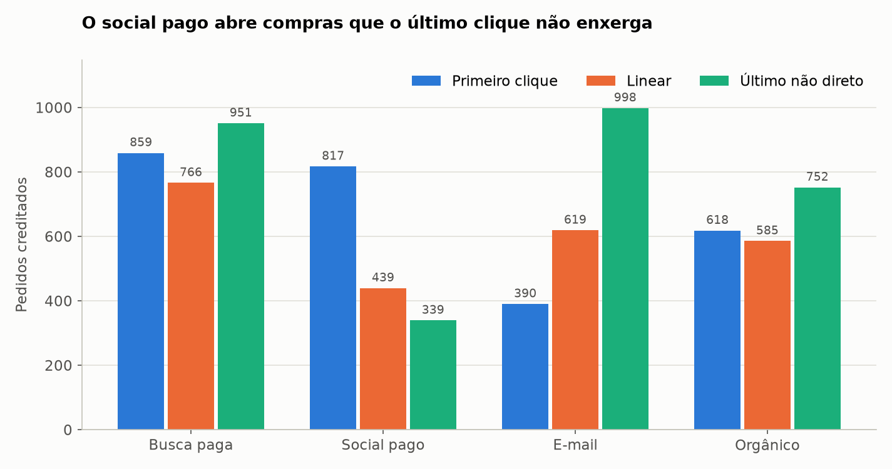
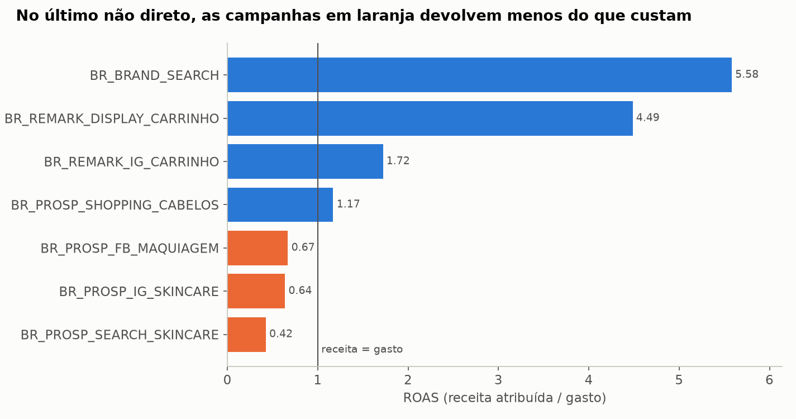
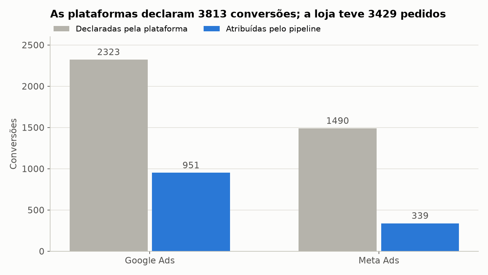
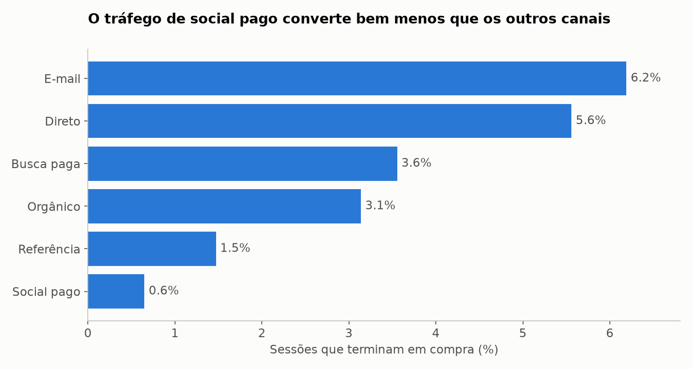
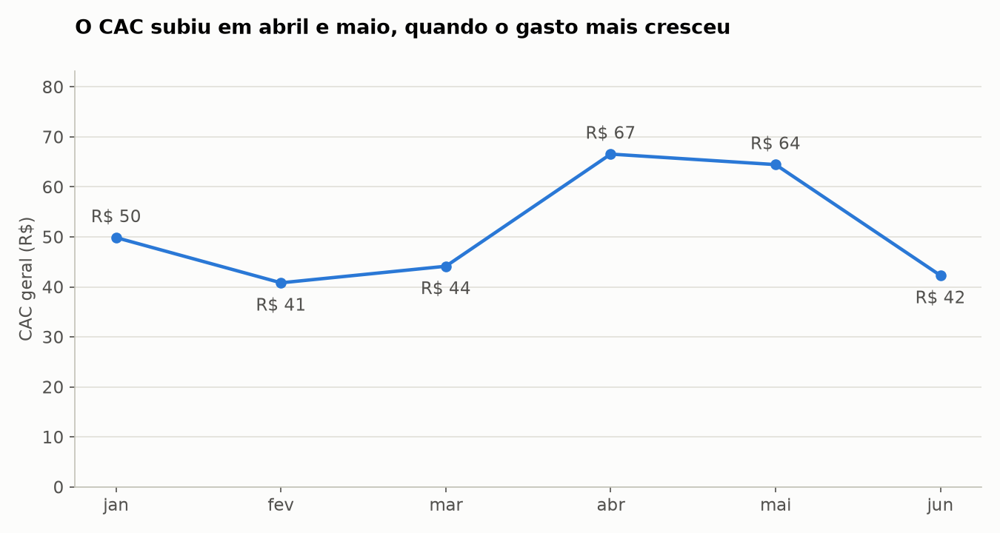
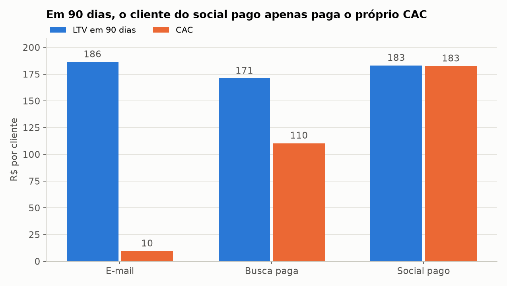
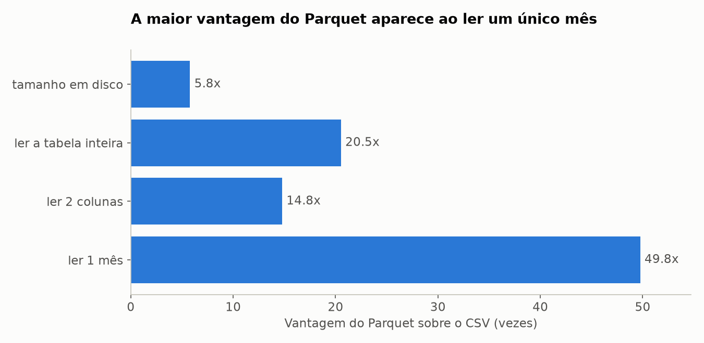

# 06 · Marketing Multi-source ETL + Parquet

ETL de marketing que junta seis fontes em quatro formatos, grava um data lake em Parquet e
responde quanto custa trazer um cliente, por canal e por campanha, em cinco modelos de atribuição.

## Problema e contexto

A **Aura Cosméticos** (empresa fictícia) vende online e gastou **R$ 172 mil em mídia** no primeiro
semestre de 2025. Cada plataforma diz que foi a responsável pelas vendas, e os números não fecham:
somadas, Google e Meta declaram mais conversões do que a loja teve de pedidos.

O objetivo é montar uma base única e confiável para decidir a verba: qual o CAC e o ROAS reais de
cada canal, o quanto essa resposta depende do modelo de atribuição e se o cliente adquirido se paga.

## Origem dos dados

Os dados são sintéticos, gerados por `scripts/generate_data.py` com semente fixa. A API é um
servidor HTTP local (`mock/ads_api.py`) que imita uma API de anúncios real.

| Fonte | Formato | Volume | O que traz |
|---|---|---|---|
| Google Ads | API REST paginada, JSON aninhado | 724 linhas | gasto diário por campanha, em milionésimos de real |
| Meta Ads | Excel, uma aba por mês | 549 linhas | gasto diário por campanha |
| E-mail | CSV com número e data no padrão brasileiro | 27 linhas | envios semanais e custo |
| Sessões do site | JSON Lines comprimido, um arquivo por mês | 106.238 linhas | UTMs, dispositivo e etapas do funil |
| Pedidos | CSV | 3.755 linhas | valor, desconto, frete e status |
| Clientes | JSON | 3.541 linhas | UF e data de cadastro |

## Problemas encontrados e tratamento

| Problema | Onde | Tratamento |
|---|---|---|
| Limite de requisições (429) e erros 500 | API | novas tentativas respeitando `Retry-After` e espera exponencial; a carga fez 17 requisições e 5 novas tentativas |
| Paginação e JSON aninhado | API | janelas de data, leitura de todas as páginas e `json_normalize` |
| Custo em milionésimos (`costMicros`) | API | conversão para reais |
| Coluna renomeada em abril (`Valor usado` virou `Valor gasto`) | Excel | contrato com apelidos unifica as colunas e registra um alerta |
| Cabeçalho na 4ª linha e linha de total em cada aba | Excel | leitura ajustada; os totais viram controle da soma |
| Valores como `R$ 1.000,50` misturados com números | Excel, CSV | conversão centralizada em `parse_numero` |
| UTMs inconsistentes (`Google`, `gads`, `ig`, `paid-social`) | Sessões | regras de canal em `config/canais.yaml` |
| Nomes de campanha com maiúsculas e espaços diferentes | Excel, sessões | normalização antes de cruzar gasto e sessão |
| 3 robôs com 4.500 sessões | Sessões | mais de 30 sessões por dia vai para a quarentena |
| 1.017 sessões do ambiente de homologação | Sessões | filtro por hostname |
| 25 pedidos de teste e 19 duplicados | Pedidos | quarentena com motivo |
| Pedidos sem visitante ou sem sessão na janela | Pedidos | ficam como `nao_atribuido`, para a receita fechar |

Os robôs mostram por que filtrar antes de medir: todos caíram em `BR_PROSP_SEARCH_SKINCARE`. Sem o
filtro, a conversão dessa campanha seria de 1,2%, e não de 2,1%.

## Arquitetura

```text
Google Ads (API)  ─┐
Meta Ads (Excel)  ─┤
E-mail (CSV)      ─┤  conectores    landing/        contratos     curated/        marts/
Sessões (JSONL)   ─┼─────────────▶  bruto, em  ───────────────▶  limpo, tipado ─▶ funil, CAC, ROAS,
Pedidos (CSV)     ─┤  por tipo      texto           + curadoria   por mês         LTV, atribuição
Clientes (JSON)   ─┘                                                                   │
                                                                                       ▼
                             verificações ─▶ relatório, gráficos e run_manifest.json
```

```text
06-marketing-etl/
├── config/          pipeline.yaml (fontes, contratos, regras) e canais.yaml
├── data/
│   ├── raw/         arquivos das fontes
│   ├── external/    gabarito do gerador, usado na conciliação
│   └── lake/        landing, curated e marts (gerado, fora do Git)
├── mock/            API de anúncios simulada
├── output/          relatório, tabelas, gráficos e manifesto
├── scripts/         gerador dos dados
├── src/
│   ├── connectors/  api.py, arquivos.py
│   ├── settings.py  contracts.py  lake.py  curate.py
│   └── attribution.py  metrics.py  quality.py  benchmark.py  report.py  visualize.py
├── tests/
└── main.py
```

## Decisões de engenharia

- **Configuração fora do código.** Incluir uma fonte ou mudar uma regra é uma alteração no YAML.
  O campo `tipo` escolhe o conector, e a configuração é validada na partida.
- **Contratos de dados.** Cada fonte declara colunas, tipos e apelidos. Coluna renomeada é
  unificada e vira alerta; coluna obrigatória ausente interrompe a carga.
- **Segredos pelo ambiente.** O token da API vem de `ADS_API_TOKEN`. O `.env` não é versionado, e o
  valor padrão só é aceito quando a fonte aponta para a API simulada.
- **Lake em três camadas.** A landing guarda o dado como chegou, para reprocessar sem consultar a
  fonte de novo. A curated usa schema pyarrow explícito, então um tipo errado falha na escrita, e
  não em quem lê depois. As etapas seguintes leem do lake, e não da memória.
- **Reprocessamento idempotente.** Reescrever um mês substitui só aquela partição.
- **Conciliação em vez de confiança.** Gasto e receita são comparados com a fonte bruta, com os
  totais da planilha e com o gabarito. Em todos os modelos, os créditos de cada pedido somam 1.
- **Coortes observadas por inteiro.** Uma coorte só entra no marco de LTV se todos os seus clientes
  já completaram o prazo. Por isso, o marco de 90 dias só tem as coortes de janeiro a março.

## Tecnologias

Python 3.14, Pandas 3, PyArrow, Requests, PyYAML, openpyxl, Matplotlib e pytest.

## Como executar

```bash
python3 -m venv .venv
```

```bash
source .venv/bin/activate
```

```bash
pip install -r requirements.txt
```

```bash
python main.py
```

```bash
pytest
```

Os dados já estão no repositório. Para gerá-los de novo, use `python scripts/generate_data.py`.
O `main.py` sobe a API simulada sozinho e termina com código diferente de zero se uma verificação
crítica falhar. Para pular a comparação de formatos, use `python main.py --sem-benchmark`.

## Resultados obtidos

| Indicador | Valor |
|---|---|
| Gasto de mídia | R$ 172.353,04 |
| Receita paga, sem frete | R$ 573.540,18 |
| Pedidos pagos | 3.429 |
| Clientes novos | 3.282 |
| CAC geral | R$ 52,51 |
| ROAS geral | 3,33 |

Desempenho por canal no modelo padrão (último não direto):

| Canal | Gasto (R$) | Pedidos | Receita (R$) | CAC (R$) | ROAS |
|---|---:|---:|---:|---:|---:|
| E-mail | 8.858 | 998 | 170.396 | 9,51 | 19,24 |
| Busca paga | 102.340 | 951 | 154.566 | 110,40 | 1,51 |
| Orgânico | 0 | 752 | 127.121 | | |
| Social pago | 61.155 | 339 | 55.027 | 182,55 | 0,90 |
| Não atribuído | 0 | 191 | 30.285 | | |
| Direto | 0 | 139 | 25.597 | | |
| Referência | 0 | 59 | 10.549 | | |

### O modelo de atribuição muda a decisão



| ROAS | Primeiro clique | Linear | Decaimento | Último não direto | Último clique |
|---|---:|---:|---:|---:|---:|
| E-mail | 7,27 | 11,73 | 12,43 | 19,24 | 15,87 |
| Busca paga | 1,40 | 1,23 | 1,21 | 1,51 | 1,11 |
| Social pago | 2,25 | 1,20 | 1,03 | 0,90 | 0,29 |

O social pago vai de 0,29 a 2,25 conforme o modelo: ele abre a jornada, e o e-mail fecha. Cortar
essa verba olhando só o último clique pode reduzir as compras que o e-mail hoje recebe como crédito.

### Onde a verba rende menos



`BR_PROSP_SEARCH_SKINCARE` sozinha consome 34% do gasto, com ROAS de 0,42 e CAC de R$ 351,88. É a
primeira candidata a revisão. Já `BR_BRAND_SEARCH` e `BR_REMARK_DISPLAY_CARRINHO` têm ROAS de 5,58 e
4,49, mas capturam quem já conhece a marca, então esse retorno não se repete com mais verba.

### As plataformas contam a mesma venda mais de uma vez



Google e Meta declaram 3.813 conversões, mais do que os 3.429 pedidos de toda a loja, incluindo os
que vieram de e-mail e orgânico. Contra o pipeline, o excesso é de 144% no Google e 340% na Meta.

### Funil e evolução do CAC



O social pago converte 0,6% das sessões, contra 3,6% da busca paga. A maior queda está no fim do
funil: só 10% de quem inicia o checkout vindo desse canal conclui a compra na mesma sessão.



O CAC geral subiu de R$ 44 em março para R$ 67 em abril, com o gasto de R$ 25 mil para R$ 34 mil.
Em maio, o gasto chegou a R$ 51 mil, com CAC de R$ 64. Em junho, a verba voltou a R$ 26 mil e o CAC, a R$ 42.

### O cliente se paga?



| Canal de aquisição | LTV em 90 dias (R$) | CAC (R$) | LTV/CAC |
|---|---:|---:|---:|
| E-mail | 186,37 | 9,51 | 19,6 |
| Busca paga | 170,96 | 110,40 | 1,5 |
| Social pago | 183,08 | 182,55 | 1,0 |

O LTV quase não varia entre coortes (R$ 178 a R$ 181 em 90 dias), porque só 4,4% dos clientes
compraram de novo no período. A diferença entre canais vem do CAC, e a recompra é a maior
oportunidade fora da mídia.

### CSV contra Parquet



| Medida (100.721 sessões) | CSV | Parquet | Vantagem |
|---|---:|---:|---:|
| Tamanho em disco | 10,7 MB | 1,9 MB | 5,8x |
| Ler a tabela inteira | 77 ms | 3,7 ms | 21x |
| Ler 2 colunas | 22 ms | 1,5 ms | 15x |
| Ler 1 mês | 80 ms | 1,6 ms | 50x |

Os tempos são a mediana de cinco leituras, com os arquivos já no cache do sistema, e mudam de uma
máquina para outra. Ler um mês é o melhor caso: a partição evita abrir os outros cinco meses,
enquanto o CSV precisa ser lido inteiro.

### Qualidade

Todas as 16 verificações críticas passaram, incluindo os oito valores do gabarito, que bateram
exatamente. Dois alertas ficam registrados de propósito: a coluna renomeada da Meta e as conversões
declaradas acima dos pedidos reais. O detalhe está em [output/relatorio.md](output/relatorio.md).

## Limitações

- **Atribuição não mede incrementalidade.** Os modelos dividem crédito, mas não dizem o que
  aconteceria sem o anúncio. Para isso, seriam necessários testes de holdout.
- **LTV é receita, não margem.** Com os custos do produto, o social pago ficaria abaixo de 1.
- **O CAC do e-mail é otimista.** Quem recebe e-mail já está na base, e o custo de levar essa
  pessoa até a lista está em outros canais.
- **Só há visão entre sessões do mesmo visitante.** Troca de dispositivo e cookies apagados quebram
  a jornada, o que explica parte dos pedidos não atribuídos.
